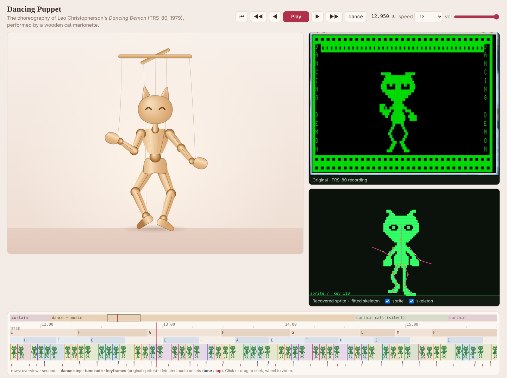

# Dancing Puppet

A wooden cat marionette performs the choreography of Leo Christopherson's
**Dancing Demon** (TRS-80, 1979). The dance was recovered from the
original sprite data, by running George Phillips' *Doubled Dancing Demon*
cassette in a cycle-counting Z80 emulator. It was timed against the supplied
recording of the original and is played in sync with that recording's music.



## Run it

Requires Node.js 20+ (tested with 22).

```bash
npm install
```

```bash
npm run dev
```

Open http://localhost:5173 and press **Play**. Browsers only start audio
after a click.

Other commands:

```bash
npm run build      # type-check + static build into dist/
```

```bash
npm run preview    # serve dist/
```

```bash
npm test           # rig integrity + choreography sampling checks
```

The app loads its data with `fetch`, so it must be served over HTTP (dev
server, `preview`, or any static server), not opened as a `file://` page.

## Using it

* **Stage** (left): the marionette, its control bar and strings, and the stage
  curtain.
* **Original · TRS-80 recording** (top right): the reference video, slaved to
  the same clock.
* **Recovered sprite + fitted skeleton** (bottom right): the exact original
  sprite the program shows at this instant (flip-book), plus the skeleton
  driving the marionette, drawn with the demon's proportions. This is the
  pose-fidelity check.
* **Timeline**: overview (curtain / dance / silent curtain call), seconds,
  dance-step letters, tune-note letters, keyframes with sprite thumbnails, and
  detected audio onsets (tones / taps). Click or drag to seek; the mouse wheel
  zooms.
* **Keys**: Space play/pause · ←/→ ±1/60 s · Shift+←/→ previous/next keyframe ·
  `,`/`.` ±1 video frame · Home restart · `S` skeleton · `G` ghost · `E` edit.
* **Motion** settings: *smooth* (default), *linear*, or *original
  flip-book* (shows exactly what the TRS-80 showed, frame for frame). There are
  also transition phase and maximum transition length.
* **Sync**: A/V offset, reference-video offset, audio output-latency
  compensation, and playback speed (audio pitch follows the speed).

### Correcting poses and timing

Turn on **edit mode** (`E`). Playback pauses and the editor shows the pose of
the keyframe at the playhead, or of one you click on the timeline.

* Drag a bone end on the stage to rotate that joint, or use the sliders (all
  joints, root offset, head yaw / pitch).
* A pose belongs to one original sprite, so a correction applies to every
  keyframe that shows that sprite.
* Retime a keyframe by dragging it on the timeline, or with the ±1/60 s and
  ±5 ms buttons.
* Edits autosave in this browser. **Download choreography.json** saves the
  whole file; drop it in `public/data/` to make it permanent. **Copy overrides
  JSON** copies entries for `data/pose_overrides.json`, which the data pipeline
  applies on every rebuild.

## How it works

```
src/
  types.ts                 data formats shared with the JSON files
  rig/skeleton.ts          hierarchical skeleton, forward kinematics, rigidity check
  anim/choreography.ts     keyframes -> per-channel tracks -> pose(t); editing API
  audio/clock.ts           master clock (WebAudio sample clock, latency compensated)
  render/puppet.ts         marionette artwork: rigid parts drawn in bone frames
  render/stage.ts          background, contact shadow, control bar + strings, curtain
  render/overlay.ts        skeleton overlay, sprite ghost
  ui/reference.ts          reference video sync + ghost panel
  ui/timeline.ts           timeline (seek, zoom, keyframe retiming)
  ui/inspector.ts          live pose read-out, pose/timing editor, export
  main.ts                  wiring and render loop
public/data/
  rig-demon.json           skeleton with the demon sprite's proportions
  rig-marionette.json      same topology, marionette proportions, strings, foot contacts
  choreography.json        sprites, poses, keyframes, steps, notes, curtain, step library
public/audio/music.wav     soundtrack of the recording (from media time 0)
public/ref/reference.*     the recording (from media time 0)
```

* **Skeleton.** 16 bones: pelvis (root) → waist → neck → head; shoulder →
  elbow → wrist on both sides; hip → knee → ankle on both sides. Every part is a
  rigid shape authored in its bone's frame and placed with a
  rotate + translate transform. No part ever bends, stretches or skins.
  `npm test` checks over the whole show (sampled at 1 kHz, every interpolation
  mode) that every segment keeps its length (max error ≈ 1e-14).
* **One choreography, two bodies.** Poses are local joint angles plus a root
  offset (degrees, clockwise-positive, y down; rest pose = all zeros, standing).
  The same pose drives the demon-proportioned rig (overlaid on the original
  sprite) and the marionette rig. Root motion is scaled by the ratio of hip
  heights. The marionette's feet are re-grounded every frame: a foot that
  touches the floor in the original touches it here, and airborne frames (the
  jump) keep their height.
* **Interpolation.** The original is a flip-book. A short transition window
  (≤110 ms, never longer than the neighbouring poses) is centred near each
  flip. Long poses are held exactly, and fast passages flow through every pose
  using a monotone cubic (no overshoot, eases at reversals). Snaps stay snappy:
  the jump flips some poses for a single 60 Hz frame.
* **Sync.** Every frame computes the pose from `clock.time`. Nothing accumulates
  per-frame deltas, so there is no drift. While playing, that time is the
  AudioContext sample clock of the music, minus the output latency. The video
  is nudged with small playback-rate corrections (seeking only on jumps of more than 250 ms).
  Audio, video and data share one time base: media time 0 = frame 600
  (20.020 s) of the recording, with audio trimmed sample-exactly (verified by
  cross-correlation).

## What was recovered and what was approximated

| Element | Source | Status |
|---|---|---|
| Pose sequence (which sprite, in which order) | emulation of the program; video for the curtain call | **recovered** (28 + 3 sprites) |
| Pose timing | emulated 60 Hz frame sequence, time-warped onto the recording | **recovered**, ±18 ms (std) vs the recording |
| Stage travel and jump height | emulated window position | **recovered**, matches the video exactly |
| Dance-step structure, tune letters | program data (`0xA81F`, `0xA67D`) | **recovered** |
| Music | the recording's soundtrack | used as is (high-pass filtered) |
| Curtain timing | measured in the video | **recovered** |
| Joint angles of each sprite | automatic fit of the skeleton to the sprite pixels | **approximated** (mean 20% of sprite pixels unexplained; review sheets reproducible) |
| Head turn, back view, bow, curtain-call arms | read by eye (`data/pose_overrides.json`) | **approximated / hypothesis** |
| In-betweens | interpolation (the original has none) | **new** |

The research details (cassette format, addresses, beam-racing kernel, sound
routine, timing structure) are in [docs/FINDINGS.md](docs/FINDINGS.md).

## Fidelity (measured, `tools/fidelity_report.py` → `docs/fidelity.json`)

* **Choreography and timing.** For 99.4% of the 1,100 video frames of the dance,
  the sprite the app shows (within ±1 video frame), at the app's stage position,
  explains the recorded frame as well as the best-matching sprite does (within
  12 of 840 pixels). Strict sprite identity is 76% exact and 89% within ±1
  frame. Most strict misses are sprites 3 and 15, which are almost identical at
  the recording's resolution.
* **Alignment.** 468/509 emulated sprite changes found in order in the
  recording. Warp residual 18 ms std, 70 ms max. The original runs 1.149×
  faster than Phillips' remake, with a small non-uniform drift.
* **Rig integrity.** Segment-length error ≤ 1.1e-14 units throughout.
* **Music.** The soundtrack is the recording's own, on the same time base as
  the video frames used for alignment. So the music-to-motion sync is the
  alignment accuracy above.

## Known discrepancies and next steps

1. **Joint fits are approximate.** The automatic fit is good for arms and legs
   but weak where the demon's art is not anatomical: squashed heads in the jump,
   back views, the bow. Next: refine the worst poses (s29, s17, s26, s24, s22)
   in edit mode against the ghost.
2. **Proportions differ.** The demon has a huge head and short legs; the
   marionette is slender. Angles transfer, but contacts such as hands on hips
   need per-pose touch-ups. Next: optional IK targets for hands (hip / head
   contacts).
3. **The bow is frontal.** A forward bow cannot be drawn by in-plane rotation of
   rigid parts. It is shown as a head nod plus a plié. Next: a 2.5D pitch
   channel with alternate head/torso art.
4. **Note markers** may lead or lag the audible notes by up to ~0.1 s (see
   findings). Next: decode the sound table and synthesise a clean soundtrack
   from the tune data, which would also give exact note times.
5. **Turn-around** reads through the head only; the body stays frontal.
   Next: alternate torso art for profile and back views.
6. Secondary motion (string sway, control-bar inertia, a little settle after
   landings) is minimal on purpose and could be added carefully.

## Rebuilding the data

Python 3.11+, ffmpeg:

```bash
pip install -r tools/requirements.txt
```

```bash
python3 tools/cas_decode.py data/source/dandem2.cas data/work/dandem.bin
```

```bash
python3 tools/emulate_dandem.py data/work/dandem.bin data/phillips.json 50
```

```bash
python3 tools/video_track.py data/source/reference.mp4 data/phillips.json data/work/video_track.json
```

```bash
python3 tools/build_timeline.py
```

```bash
python3 tools/fit_poses.py
```

```bash
python3 tools/review_fits.py data/work/poses_fit.json data/work/fit_review.png
```

```bash
python3 tools/build_data.py
```

```bash
python3 tools/fidelity_report.py
```

`fit_poses.py` takes a few minutes (it searches every limb exhaustively) and
writes to `data/work/` (git-ignored). `build_data.py` merges the fit with
`data/pose_overrides.json`.

To make a side-by-side video (recording | marionette, with the soundtrack)
while `npm run dev` is running (needs Playwright + ffmpeg):

```bash
node tools/render_compare.mjs 0 58.8 30 compare.mp4
```

## Credits

*Dancing Demon* © 1979 Leo Christopherson. The art, dance and music data come
from his program (the original is in the public domain per George Phillips'
page). Cassette: George Phillips, *Doubled Dancing Demon* (2009). Reference
recording supplied by the project owner. This project is an independent
reinterpretation.
